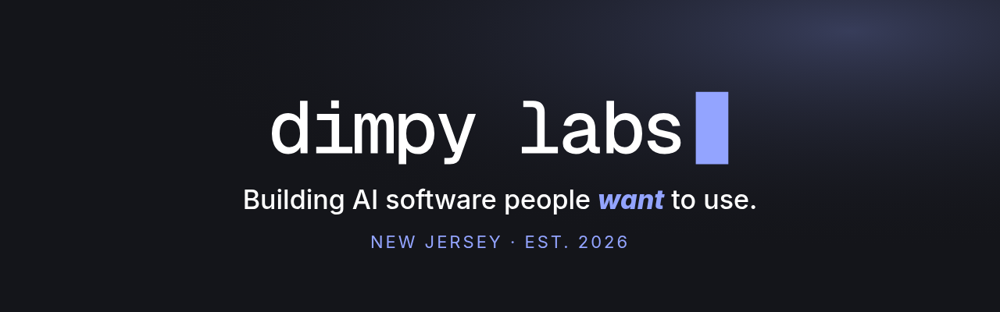

 

---

### 👋 We build software people rely on every day

Dimpy Labs is an AI software company based in New Jersey. We design, build and run our own products, and we put AI to work where it actually saves you time, and leave it out where it doesn't.

 

### 🚀 Products

| | Product | What it does | Status |
|:-:|---|---|---|
| 💬 | **[Dimpy](https://meetdimpy.us)** | Your semester, texted to you first. Dimpy reads your Canvas and texts you before every exam and due date. No app to download. | 🟢 Spring pilot, Jan 26 to Mar 6, 2027 |
| 🃏 | **[Cramdeck](https://cramdeck.fyi)** | Our next product. Stay tuned. | 🟣 Coming after finals |

 

### 🧭 What we believe

- **Built for students.** Dimpy starts with college: classes, deadlines and exams.
- **It comes to you.** Dimpy texts you first, so you never have to remember to check another app.
- **AI where it helps.** We put AI to work where it saves you time, and leave it out where it doesn't.

 

### 📍 Pilot details

> **60 seats · iPhone only · free during the pilot, then $3.99 a month.**
> Grab a spot at **[meetdimpy.us](https://meetdimpy.us)**.

---

Dimpy Labs is the trade name of Sachdeva Ventures L.L.C., a New Jersey limited liability company. Founded in 2026 by Ethan Sachdeva.
 
<i>Better software for a better tomorrow.</i>

